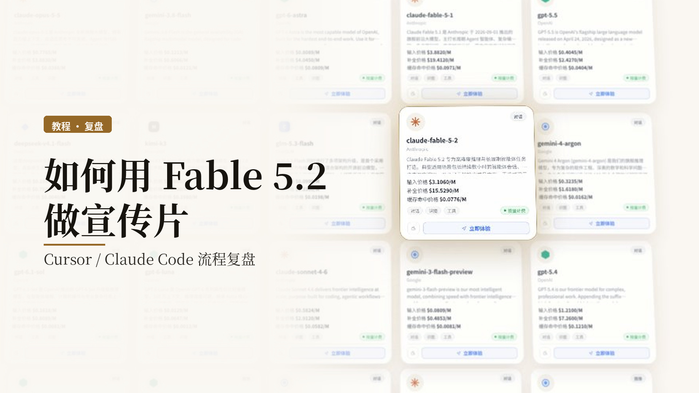
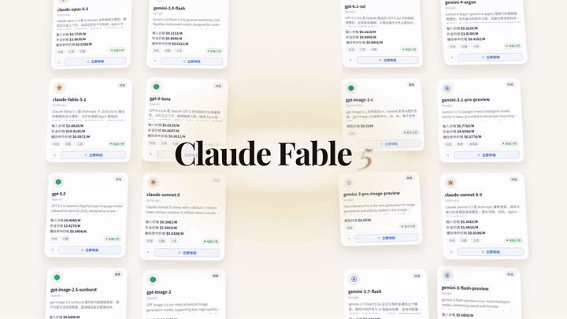
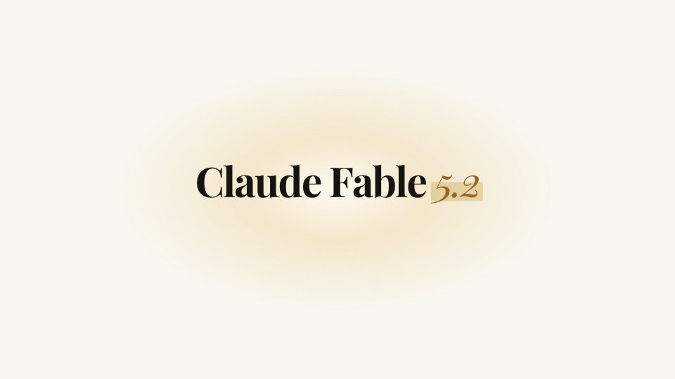
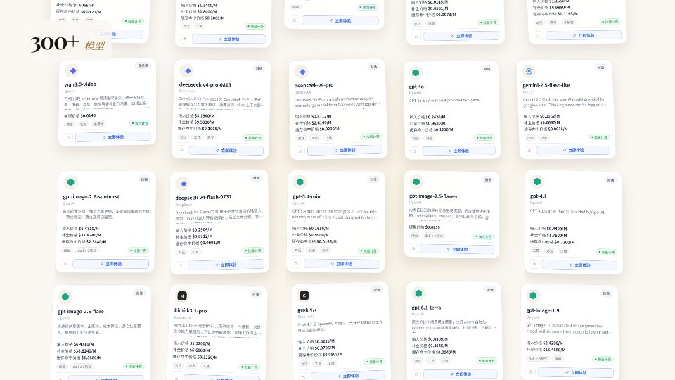
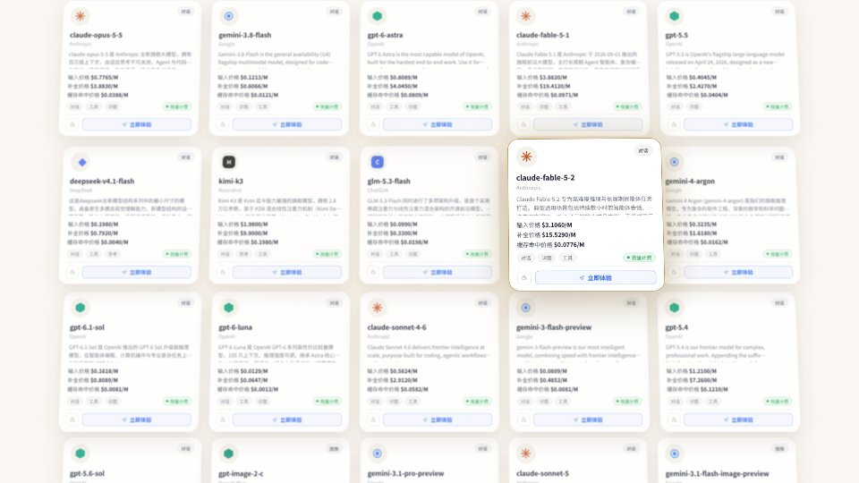
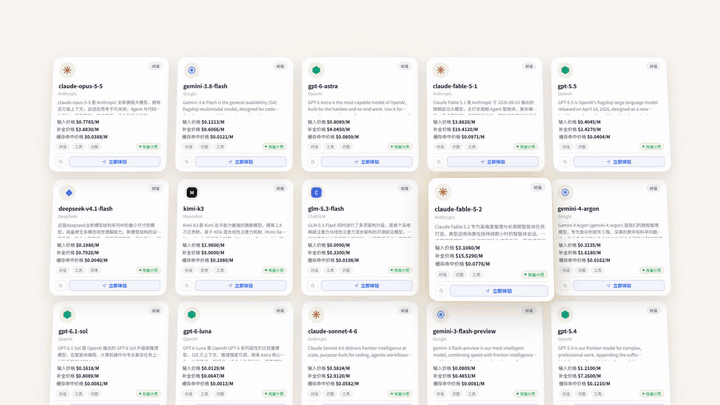
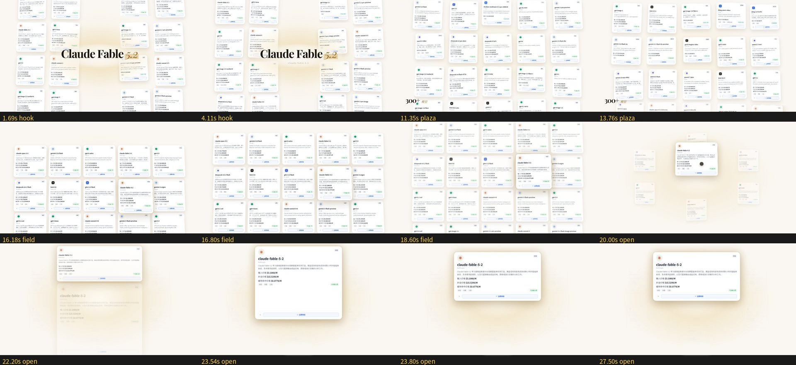
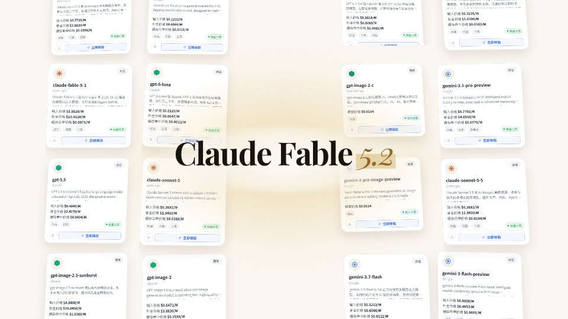

# 如何用 Fable 5.2 做 AI 产品宣传片（流程复盘）



这次我用 Fable 5.2，配合一套开源的宣传片 Skill，在 Cursor 和 Claude Code 里做了一支产品宣传片：16:9、60 帧、大约 50 秒。画面不是网站截图，而是用 Remotion 重绘的模型广场卡片风——卡片铺开，点开其中一张，能看到参数和标价。这套 Skill 背后的模型由 tryallapi.com 驱动。



这篇文章按我们实际走过的流程来写，方便对照着做。先说清楚一件事：Fable 5.2 负责调研辅助、分镜和文案；成片是 Remotion 工程渲染出来的，不是模型直接导出的 MP4。把这两步分开，后面会少走很多弯路。

## 你需要准备什么

制作过程会用到 Node.js 18 以上、Python 3.9 以上，以及 ffmpeg。这三样请先装好。其余依赖可以在开工前先检查环境是否齐全。

另外需要一个能跑 Agent 的编程工具：Cursor 或 Claude Code 都可以。这套 Skill 的仓库在 https://github.com/xianyu110/ai-promo-video-maker ，名称是 `promo-video-maker`。安装可以用：

```
npx skills add xianyu110/ai-promo-video-maker -g
```

也可以先克隆仓库：

```
git clone https://github.com/xianyu110/ai-promo-video-maker.git
```

装好后，对 AI 说「做宣传片」或「做产品介绍视频」，它就会按规范走完后面的流程。

## 按规范走：先调研和确认，再动手

这套 Skill 的核心不是某个预设模板，而是一份 AI 能照着执行的工作规范。我们实际也是按这个顺序做的，中间改过好几轮。建议你同样不要一上来就让它渲染。

**1. 调研，只写能核对的事实**

先让 AI 把产品是什么、要突出什么、哪些数字有出处，写成调研笔记。没有出处的用户量、延迟、可用性、评价，不要写进片子。我们做的时候就明确排除了这类未核实的数字。卡片上如果要出现标价，也按当时的公开页核对；Fable 5.2 当时公开标价是：输入 $3.1060/M、输出 $15.5290/M、缓存命中 $0.0776/M。日期变了，价格也可能变，不要把旧数字当永久事实。

**2. 需求确认，你点头再开工**

画幅、时长、受众、风格、配乐和旁白，都要先拍板，写成需求确认。我们这支片子确认的是：横屏 16:9、50 秒、60 帧。规范里也强调：没有确认需求之前，不要开始制作。

**3. 先看风格样帧，再定方向**

确认需求的同时，AI 会给出几个差异比较大的风格方向，并画出样帧。我们没有一次就定稿：先试过极简发布会风，再改成米白纸色、衬线标题的编辑向纸页风，后来才改成模型广场卡片——因为产品本身就是一张张模型卡，Fable 5.2 也只是其中一张，点开后才是详情。样帧可以混搭，比如「A 的配色加 C 的版式」。选定之后，再进入制作。



**4. 制作画面**

画面是在 Remotion 工程里做的。我们这版没有用网站实拍，而是按公开的模型目录，用组件把卡片重绘出来：先是一片卡片铺开，再点出 Fable 5.2 那张，展开参数。如果你的产品更适合真实界面，也可以走页面截图的路子；两种都可以，关键是先在需求里写清楚。





主插图是下面这段预览：点开卡片、展开参数，大约 6.5 秒。



（若专栏编辑器支持插入短视频，可用备用文件 `images/fable-5-2-retrospective/clip-fable-open.mp4`，大约 430KB，内容与上面这段 GIF 相同。）


**5. 配乐和卡点**

我们用的是 Mixkit 曲库里的《Drawing the Sky》。先把曲子定下来，再按节拍排分镜，比先做画面再硬贴音乐要稳。如果需要按分镜定制配乐，也可以选用 ElevenLabs 作曲，那是可选项，不是必须。

**6. 旁白和音效**

旁白我们用了 Grok TTS，音色是 rex。文案和屏幕字则是交给 Fable 5.2 写的，写完再核对事实，避免模型把没核实的句子写进去。

音效后来换成了 ElevenLabs。需要提醒一句：这套开源工具的说明里写过，ElevenLabs 免费套餐生成的内容没有商用授权。如果片子要商用，请先核对你的套餐，或者改用有明确可商用许可的音效（比如 Mixkit 里合适的条目）。

**7. 校验，再渲染**

渲染前检查缺文件、过低分辨率的图、字体缺字；渲染后检查规格、日志和响度，再按场景截图对照清单看一遍。我们是过完这些闸门，才把 1080p、60 帧的成片定下来的（同时也出过 4K 版本）。收到修改意见时，按规范只重做必要的步骤：比如只换音效，就不必把画面全部重渲。

下面这张是制作过程中的分镜对照，只保留了开场到点开卡片这一段，方便回看节奏。后半段没有放进来。



## 复盘时我觉得值得留下的几点

第一，Fable 5.2 适合做「想清楚再写下来」这件事：分镜、旁白、屏幕文案都可以交给它，但成片质量取决于你有没有把需求、样帧和事实边界先卡住。

第二，宣传片很容易做成说明书。我们改了好几轮，才从「把卖点念一遍」转到「一张卡片被点开」这种能看懂的动作。如果你也在做产品介绍，不妨先问：哪一个画面能让人 3 秒内明白这是什么。



第三，数字和版权都不要想当然。没有出处的数字不要上屏；配乐、音效、字体、Remotion 的授权范围，做之前看一眼。Remotion 对个人和 3 人以内的公司是免费的，更大的团队需要另看它的授权说明。

第四，工具会在中途只为几件事来问你：确认需求、试听配乐和音色、以及只有你才能核实的事实。这些地方不要图快跳过。制作端听不到成片里的声音，配乐和音色一定要自己听一遍再锁定。

## 从一句话到成片，可以这样开始

1. 装好 Node.js、Python、ffmpeg。
2. 打开仓库 https://github.com/xianyu110/ai-promo-video-maker ，用 `npx skills add xianyu110/ai-promo-video-maker -g` 装好宣传片 Skill（`promo-video-maker`）。在 Cursor 或 Claude Code 里对 AI 说「做宣传片」或「做产品介绍视频」。
3. 先完成调研和需求确认，看完风格样帧，再允许它制作、混音、校验和渲染。
4. 自己试听配乐和旁白，核对屏幕上的事实，再接受成片。

以上是这一次的制作复盘。按这个顺序走，比一上来就要成片稳得多。
